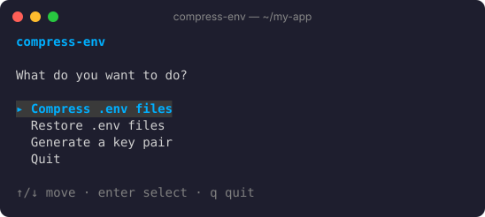
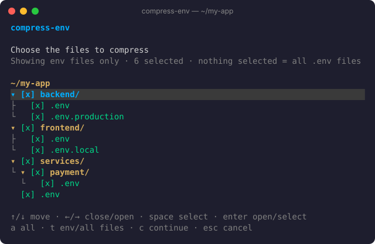
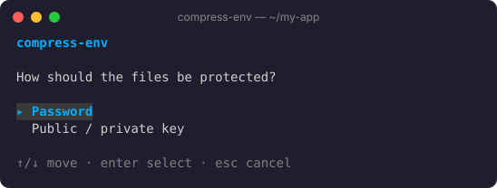
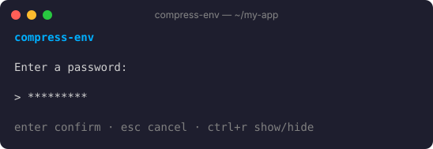
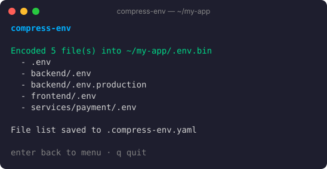
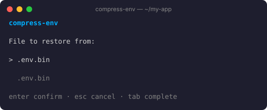
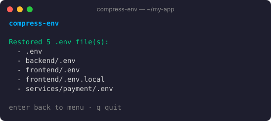
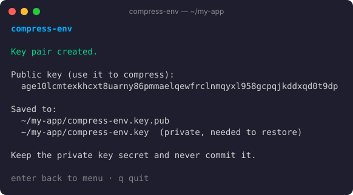
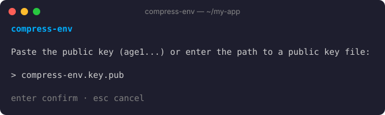
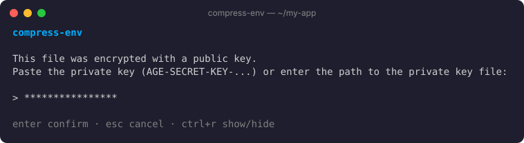

# compress-env

Pack all the `.env` files of a project into **one protected file**, commit it, and restore them anywhere.

- One file (`.env.bin`) holds every `.env` in the project tree, with its path.
- Protect it with a **password**, or with a **public key** so only the holder of the private key can restore it.
- Interactive menu with a file tree picker, or plain commands for scripts and CI.
- Single binary for macOS, Linux and Windows. Install it on your machine, or drop it into one project as `./compress-env`.



## Contents

- [Install](#install)
- [Quick start](#quick-start)
- [Interactive menu](#interactive-menu)
- [Commands](#commands)
- [What to commit](#what-to-commit)
- [FAQ](#faq)

## Install

Choose one of the two ways.

### 1. On your machine (for all projects)

```bash
# macOS / Linux
curl -fsSL https://raw.githubusercontent.com/cavaldos/compress-env/main/scripts/install.sh | sh
```

```powershell
# Windows (PowerShell)
irm https://raw.githubusercontent.com/cavaldos/compress-env/main/scripts/install.ps1 | iex
```

Then run `compress-env` from any folder.

### 2. Inside one project (only that project)

Run at the root of the project. It downloads one file, `compress-env`, for your machine. Nothing is installed elsewhere.

```bash
# macOS / Linux
curl -fsSL https://raw.githubusercontent.com/cavaldos/compress-env/main/scripts/install.sh | sh -s -- --project
```

```powershell
# Windows (PowerShell)
$env:PROJECT='1'; irm https://raw.githubusercontent.com/cavaldos/compress-env/main/scripts/install.ps1 | iex
```

Then use it from the project root:

```bash
./compress-env          # macOS / Linux
.\compress-env          # Windows
```

You can commit it so it is already there after `git clone`. It only runs on the OS / CPU it was downloaded for, so teammates on another system run the command above once.

> Pin a version with `VERSION=v0.2.0`. To build it yourself, see [docs/BUILD.md](docs/BUILD.md).

## Quick start

```bash
cd my-app
compress-env compress -p my-secret     # writes .env.bin
git add .env.bin && git commit -m "chore: update env"

# on another machine, after git clone / pull
compress-env restore -p my-secret      # recreates every .env file
```

Or run `compress-env` with no arguments and follow the menu.

## Interactive menu

```bash
compress-env
```

Move with `↑`/`↓` (or `j`/`k`), confirm with `enter`, go back with `esc`, quit with `q`.

### Compress

**1. Choose the files.** The tree shows every env-like file (`.env`, `.env.local`, `prod.env`, ...) under the current folder. `.git`, `node_modules`, `.venv`, ... are skipped.



| Key             | Action                                   |
| --------------- | ---------------------------------------- |
| `↑` `↓`         | Move                                     |
| `←` `→`         | Close / open a folder                    |
| `space` or `x`  | Select / unselect (a folder selects all inside) |
| `a`             | Select / unselect everything             |
| `t`             | Show env files only / all files          |
| `c`             | Continue                                 |
| `esc`           | Back to the menu                         |

Selecting nothing compresses every file named `.env`. Your choice is saved to `.compress-env.yaml`, so it is ticked again next time:

```yaml
files:
  - .env
  - backend/.env
  - backend/.env.production
  - frontend/.env
  - services/payment/.env
```

**2. Choose how to protect them.**



**3. Enter a password** (twice), or a public key (see [Public / private key](#public--private-key)). Press `ctrl+r` to show or hide what you type.



**4. Name the output file** (default `.env.bin`). Done:



### Restore

**1. Pick the file to restore from.** Press `tab` to complete file names. Leave it empty for `.env.bin`.



**2. Enter the password** (empty if none was used). If the file was protected with a public key, you are asked for the private key instead.

**3. Done.** Every file is written back to its path, creating folders when needed. Existing files with the same path are **overwritten**.



### Public / private key

Use a key pair when you don't want to share a password: anyone with the **public key** can compress, only the **private key** can restore. Keys use [age](https://age-encryption.org) encryption.

**1. Generate a key pair** from the menu (`Generate a key pair`). It creates two files in the current folder:



| File                   | Share it?                                                      |
| ---------------------- | -------------------------------------------------------------- |
| `compress-env.key.pub` | Yes. Commit it, so everyone can compress.                      |
| `compress-env.key`     | **Never.** Keep it in a password manager. Needed to restore.   |

**2. Compress** and choose `Public / private key`. Paste the public key (`age1...`) or type the path to the `.pub` file:



**3. Restore** as usual. compress-env sees that the file uses a key and asks for the private key (`AGE-SECRET-KEY-...`) or its path:



> Key-protected files can only be restored from the menu, not with `compress-env restore`.

## Commands

For scripts and CI. Commands use passwords only.

```
compress-env                      open the interactive menu
compress-env compress [options]   pack .env files into one file
compress-env restore  [options]   recreate .env files from that file
compress-env -h | --help          show help
compress-env -v | --version       show the version
```

| Option                 | Command    | Meaning                                    | Default    |
| ---------------------- | ---------- | ------------------------------------------ | ---------- |
| `-p <password>`        | both       | Password                                   | none       |
| `-o <file>`            | `compress` | Output file                                | `.env.bin` |
| `-f <file> <file> ...` | `compress` | Only these files                           | every file named `.env` in the tree |
| `-i <file>`            | `restore`  | Input file                                 | `.env.bin` |

Examples:

```console
$ compress-env compress -p my-secret
Compressing and encoding .env files...
Searching for .env files in: ~/my-app
Encoded .env contents saved to ~/my-app/.env.bin

$ compress-env compress -f backend/.env frontend/.env -o dev.bin -p my-secret
Compressing and encoding .env files...
Compressing specified .env files...
Encoded .env contents saved to ~/my-app/dev.bin

$ compress-env restore -i dev.bin -p my-secret
Decoding and restoring .env files from backup...
Reading from: dev.bin
Restored 2 .env files:
  - ~/my-app/backend/.env
  - ~/my-app/frontend/.env
```

Notes:

- Without `-f`, `compress` only takes files named exactly `.env`. Use `-f` (or the menu) for `.env.local`, `.env.production`, ...
- The password is visible in your shell history. In CI, pass it from a secret: `compress-env restore -p "$ENV_PASSWORD"`.
- A wrong password fails with `Error: Invalid UTF-8 sequence or incorrect password` and exit code 1.

## What to commit

| File                        | Commit? |
| --------------------------- | ------- |
| `.env.bin` (or your output) | Yes     |
| `.compress-env.yaml`        | Yes, so everyone compresses the same files |
| `compress-env.key.pub`      | Yes     |
| `compress-env` (project install) | Optional, if your team uses the same OS |
| `.env`, `.env.*`            | **No**  |
| `compress-env.key`          | **No**  |

Suggested `.gitignore`:

```gitignore
.env
.env.*
!.env.bin
compress-env.key
```

## FAQ

**I forgot the password / lost the private key.** The files cannot be recovered. Keep them in a password manager.

**Password or key pair?** A password is simpler for a small team. A key pair is better when many people (or CI) need to update `.env.bin` but only a few should read it.

**`./compress-env: Permission denied`.** Run `chmod +x compress-env`. If it is committed, keep the fix with `git update-index --chmod=+x compress-env`.

**`./compress-env: cannot execute binary file` (or `exec format error`).** The file was downloaded for another OS / CPU. Run the project install command again on this machine.

## License

MIT
